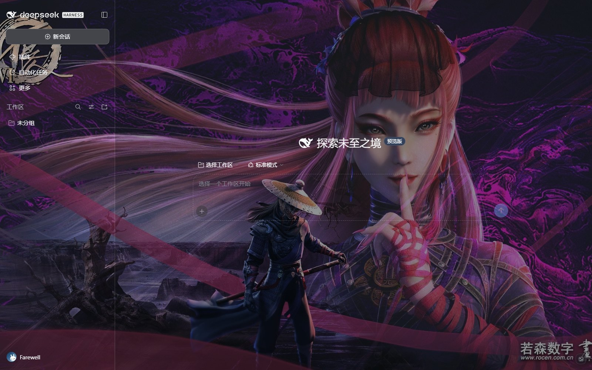
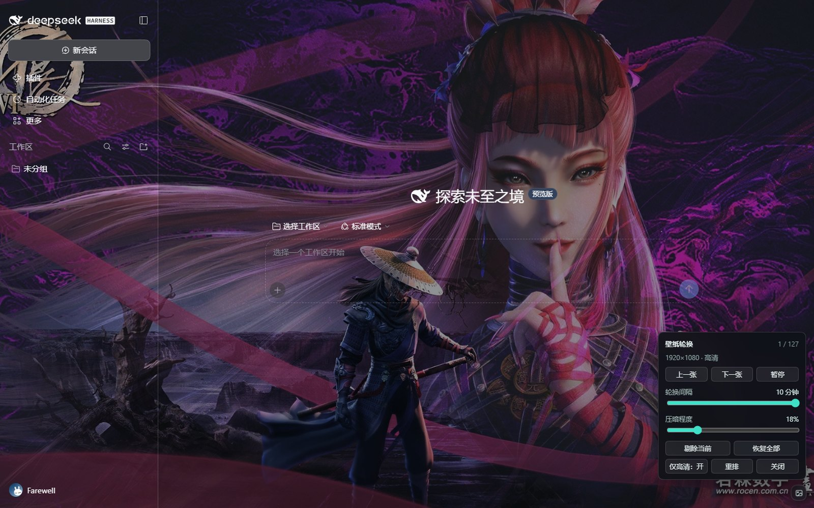

# wallpaper-rotator-v2

> 给 DeepSeek Harness（DSH）窗口铺一层**满屏、随机、4K**的壁纸轮换背景：
> 图源直接来自本机 Wallpaper Engine 库，场景壁纸从 `scene.pkg` 里现场解出 4K 静帧，
> 控件只有右下角一个 26px 的小圆钮。





## 它解决什么

DSH 自带的界面是深浅两套纯色。想要壁纸，通常会遇到四个坑，这个项目是逐个填掉的：

| 坑 | 这里怎么做 |
|---|---|
| 只能在内容区显示，侧栏/标题栏还是实底 | 独立 `position:fixed` 壁纸层 + 逐元素放行大块不透明容器 + 独立压暗层 |
| 桌面端顶部有一条白边 | 定位到 Electron `titleBarOverlay` 与页面 `::before` 共用 `--dsw-specific-sidebar-fill`，把该变量置透明后两处同时消失（见 `docs/windows-titlebar.md`） |
| 场景壁纸只有 160–192px 的预览图，铺满必糊 | 用 RePKG 解开 `scene.pkg`，挑图层合成为 3840×2160 静帧（见 `docs/quality-pipeline.md`） |
| 轮换顺序固定、开机总从同一张开始 | 每次 DSH 启动 Fisher–Yates 重洗，放完一轮才重复 |

## 特性

- **满屏不透明**：壁纸层固定铺满视口，界面只做半透明压暗，不存在"只有工作区有图"
- **随机开局**：每次启动重新洗牌，面板里「重排」可随时再洗
- **真高清**：视频型直接播原始 mp4（HTTP Range 流式，不转码）；场景型用离线提取的 4K 静帧
- **画质分级**：默认「仅高清」，低清源自动排除；面板显示当前源的分辨率
- **不喜欢就剔除**：一键把当前壁纸移出轮换池，随时可「恢复全部」；剔除列表持久化
- **新订阅自动进池**：目录每 2 分钟重扫；新场景包由后台看门狗自动解包合成
- **应用内小控件**：26px 圆钮，点开 236px 面板（上一张 / 下一张 / 暂停 / 间隔 / 压暗 / 重排 / 仅高清 / **剔除当前** / **恢复全部**）
- **零外部依赖搬运**：图片走流式 + `ETag`，不转 base64；不在磁盘上留帧、不留 MP4

## 前置条件

- Windows + 本机已安装 **Wallpaper Engine**（Steam 应用 431960），且订阅了一些壁纸
- **DeepSeek Harness** 0.2.1 或更新的预览版（桌面端，或 `dsh web` 自托管实例）
- 可选：**RePKG**（`scene.pkg` 解包，只有想要场景壁纸 4K 静帧时才需要）
- 可选：**Python 3.10+** 与 Pillow（同上）

## 安装

### A. `dsh web` 自托管实例（推荐先在这里试）

```bash
# 1) 装壁纸目录服务（开源，随 DSH 启停在 127.0.0.1:8088）
dsh plugin --profile web add dsh-wallpaper-engine-api

# 2) 把本仓库的 plugin/ 放到 profile 的 node_modules 下，并在 profile 的 package.json 里
#    dsh.profile.bundles 追加一项： "wallpaper-rotator-v2"
#    （或者直接在 profiles/<name>/cordis.patch.yml 里写 insert，见 docs/architecture.md）
```

### B. 桌面端

桌面端的 profile 目录下有 `node_modules`，最省事的做法是**把本仓库放在任意位置，再从 profile 建目录链接**，这样 C 盘只留一个 1 字节的重解析点：

```powershell
# 以管理员或普通用户均可（junction 不需要提权）
cmd /c mklink /J "%USERPROFILE%\.dsh\profiles\desktop\node_modules\wallpaper-rotator-v2" "<本仓库绝对路径>\plugin"
```

然后在 `%USERPROFILE%\.dsh\profiles\desktop\cordis.patch.yml` 末尾追加：

```yaml
- insert:
    - id: wallpaper-rotator-v2
      name: wallpaper-rotator-v2
```

重启 DSH。仓库内 `scripts/deploy-desktop.ps1` 已把上述步骤与回滚都封装好（带备份）。

> 注意：如果你用插件市场之类的工具装过别的插件，它的 `pnpm install` 可能把手工放进
> `node_modules` 的目录当多余包清掉。用 `dsh plugin add` 装成正式依赖，或装完再跑一次
> `scripts/deploy-desktop.ps1`。

## 配置

全部走环境变量，缺省值见括号：

| 变量 | 作用 | 默认 |
|---|---|---|
| `WP_WORKSHOP` | Wallpaper Engine 创意工坊目录 | `C:\Program Files (x86)\Steam\steamapps\workshop\content\431960` |
| `WP_MYPROJECTS` | 本地工程目录 | `...\wallpaper_engine\projects\myprojects` |
| `WP_WE_BASE` | 壁纸目录服务地址 | `http://127.0.0.1:8088` |
| `WP_STILLS` | 4K 静帧缓存目录 | `<仓库>/stills` |
| `WP_PYTHON` | Python 可执行文件 | `python` |
| `WP_EXTRACTOR` | 静帧提取脚本 | `<仓库>/tools/still-extract.py` |

运行时状态（间隔、压暗、仅高清）写在 `$DSH_HOME/wallpaper-rotator-v2.json`。

## 工作原理

```
Wallpaper Engine 库 ──► dsh-wallpaper-engine-api (:8088) ──► /api/wallpapers
                                                                    │
                        ┌───────────────────────────────────────────┘
                        ▼
              wallpaper-rotator-v2 (host)
                 ├─ 每 2 分钟重扫，id 变了就重洗牌
                 ├─ 场景包缺静帧 → 后台 spawn 提取脚本（带文件锁）
                 ├─ /wp/show  推进游标
                 ├─ /wp/img   图片流式输出（ETag）
                 ├─ /wp/video 视频流式输出（Range）
                 └─ /wp/config 间隔 / 压暗 / 暂停 / 重排 / 仅高清
                        │
                        ▼
              client（dsh.client 模块，桌面端与 web 通用）
                 ├─ fixed 双层壁纸 + 0.55s 交叉淡化
                 ├─ 覆盖 --dsw-* 主题变量 + 放行大块实底容器
                 ├─ 顶部/底部全宽条无差别清底（含伪元素）
                 └─ 26px 圆钮 + 236px 面板
```

细节见 [`docs/architecture.md`](docs/architecture.md)。

## 已知限制

- **场景壁纸的"动"拿不到**：`scene.pkg` 是专有格式，能解出贴图但不能重建粒子/着色器动画，所以场景型是**高质量静帧**，不是动态。
- **视频型依赖原始 mp4**：工坊作者如果把视频封进 `scene.pkg`（而不是独立 mp4），就只剩预览图可用。
- **5% 左右的场景包没有可用图层**：没有不透明背景、也没有像样的人物层时，只能退回预览图放大。
- **桌面端的标题栏**：依赖 `--dsw-specific-sidebar-fill` 这个变量名；DSH 大版本改名前需要跟着改一行。
- 只在 Windows 上验证过（路径、`mklink /J`、`titleBarOverlay` 都是 Windows 概念）。

## 目录结构

```
.
├── plugin/                 # DSH 插件（host + client），直接放进 profile
│   ├── index.js            #   路由、洗牌、静帧接入、看门狗
│   ├── client.js           #   壁纸层、主题覆盖、控件
│   ├── cordis.patch.yml
│   └── package.json
├── tools/                  # 离线画质流水线（Python + Pillow + RePKG）
│   ├── still-extract.py    #   解包 → 选层 → 合成 → 4K JPEG
│   ├── still-compose.py    #   兜底合成（无背景层时）
│   └── still-fit.py        #   极端比例 → 16:9 背景版
├── scripts/
│   ├── deploy-desktop.ps1  #   桌面端安装/回滚（junction + patch）
│   ├── start-web.ps1       #   dsh web 自托管启动
│   └── stop-web.ps1
├── docs/
└── assets/
```

## 许可

MIT。第三方组件与素材说明见 [`LICENSE`](LICENSE)。

本项目只读取你本机已有的 Wallpaper Engine 文件，**不包含、不分发任何壁纸或创意工坊内容**；
RePKG 也不随仓库分发，需要时自行下载。
